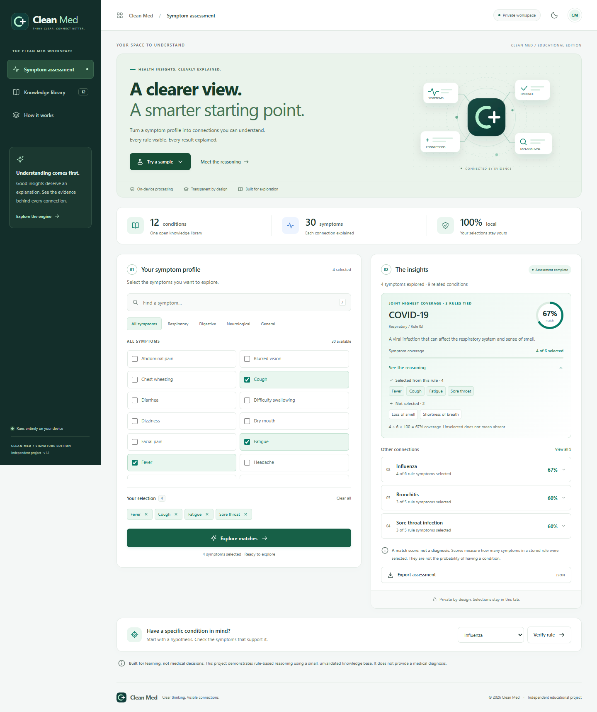
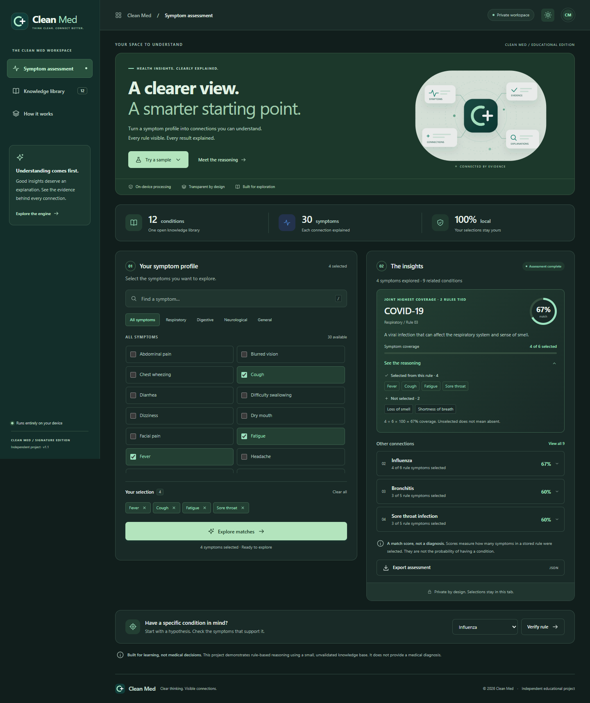
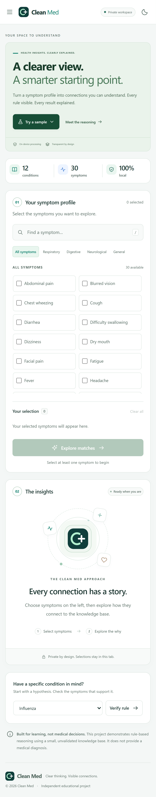

# Clean Med


**Clear thinking. Visible connections.**

An independent health-tech learning workspace with transparent, explainable reasoning.

Vanilla JavaScript · No runtime dependencies · Local processing · Responsive · Light & dark

[Quick start](#quick-start) · [The engine](#how-the-engine-works) · [العربية](docs/README.ar.md)



Clean Med turns a small academic disease-rule demo into a complete, accessible web workspace. Select symptoms, explore ranked rule matches, inspect the supporting evidence, and verify a specific hypothesis. Every score can be reproduced from the evidence displayed beside it.

**Educational software only.** This is not a diagnostic tool. The 12 hand-authored condition rules are inherited from the original project and have not been clinically validated. A match score is symptom coverage, not a probability of disease.

## What you can explore

- **Symptom workspace:** 30 searchable symptoms, category filters, removable selection chips, and three fictional sample cases.
- **Explainable results:** ranked conditions, coverage scores, complete-rule detection, and disclosures for selected, unselected, and additional symptoms. Ties are identified explicitly.
- **Backward verification:** begin with a named condition and inspect the evidence for that individual rule, including zero-coverage results.
- **Knowledge library:** search all 12 conditions and load any rule into the workspace.
- **Transparent methodology:** an in-app explanation of the formula, ordering, assumptions, and model limitations.
- **JSON export:** download the current evidence, scores, version information, and an explicit educational-use statement.
- **Thoughtful interactions:** responsive layouts, keyboard controls, screen-reader announcements, reduced-motion support, and a persistent display theme.

## Quick start

**No installation needed:** open [`index.html`](index.html) in a modern browser.  All application assets are local; no CDN, API key, backend, or network connection is required to use the app.

For a local HTTP server, install [Node.js](https://nodejs.org/) 22 or newer and run:

```sh
npm start
```

Open **<http://127.0.0.1:4173>**. The server binds to your local device. Set `PORT` to use a different port.

To work on the project and run the browser checks:

```sh
npm ci
npx playwright install chromium
npm test
npm run test:e2e
```

| Command                     | Purpose                                                              |
| --------------------------- | -------------------------------------------------------------------- |
| `npm start` / `npm run dev` | Serve the source locally; no dependencies needed                     |
| `npm test`                  | Run deterministic engine tests using Node’s built-in test runner     |
| `npm run test:e2e`          | Run Chromium desktop/mobile flows and automated accessibility checks |
| `npm run build`             | Copy the static application into `dist/`                             |

`npm run format` formats the source, and `npm run format:check` checks formatting. `npm run screenshots` regenerates the screenshots in `docs/images/`.

Playwright, axe, and Prettier are development dependencies only. They are not shipped with the website.

### More views: dark theme and mobile





## How the engine works

The knowledge base stores rules of the form:

```text
IF Headache AND Nausea AND Light sensitivity AND Dizziness AND Blurred vision
THEN the stored Migraine rule is fully satisfied
```

### Coverage scoring

```text
coverage = round(selected symptoms in the rule / total symptoms in the rule × 100)

Example: 3 selected symptoms out of 5 required symptoms = 60% coverage.
```

Every symptom has equal weight. Only conditions with at least one matching symptom appear in the ranked list. Results sort by:

1. Coverage percentage, descending.
2. Number of matched symptoms, descending.
3. Condition name, alphabetically, for reproducible ties.

Additional selected symptoms do not reduce coverage and are displayed separately. Unselected symptoms are **unknown**, not confirmed absent. Input normalization trims whitespace, ignores case, removes duplicates, and ignores symptoms outside the knowledge base.

### Two directions of evaluation

**Forward evaluation** starts from selected symptoms and checks all rules. A rule is complete when every required symptom is selected. Additional symptoms are allowed. More than one rule can be complete.

**Backward verification** starts from a chosen condition and compares its prerequisites with the same selection. This is a direct, single-rule check, not
